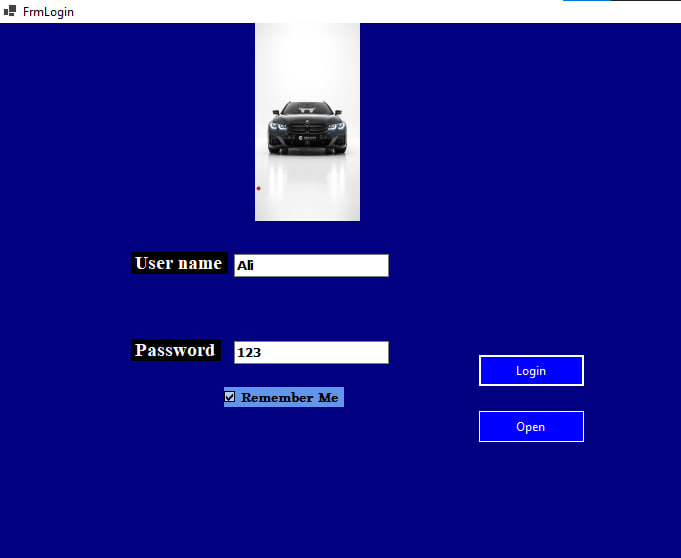

## 🚗 Car Rental Management System
 desktop application 
The system automates core business workflows—including 

customer registration, fleet tracking, rental bookings, payment transactions, and vehicle returns—while enforcing security best practices like encrypted authentication and audit logs.

📌 Project Overview
This project simulates a real-world enterprise rental management environment. It emphasizes strong software engineering principles, clear separation of concerns, and data protection:

 - DTO Pattern (Data Transfer Object): Decouples data presentation from internal domain models.
 - Service Layer Pattern: Encapsulates business rules and transactional logic.
 - Encapsulation & Layer Isolation: Ensures zero database logic leaks into the UI tier.
 -  Key Features
 - Secure Authentication & Authorization: Encrypted login, role-based access control, and user session management.
 - "Remember Me" Functionality: Secure credential caching for faster sign-ins.
 - Fleet Availability Tracking: Real-time updates on vehicle availability, status, and mileage.
 - Rental Booking Workflow: Automated calculations for rental duration, initial costs, and availability checks.
 - Vehicle Return Processing: Automatic handling of extra fees, consumed mileage, refunds, and instant status restoration.
 - Transaction Management: Tracks initial payments, remaining balances, and financial history.
 - Dashboards & Reporting: Visual indicators for business metrics and activity logs.
 - 
🏗️ Architecture

The application adopts a classic 3-Tier Architecture:
```
Presentation Layer (WinForms UI)
       │
       ▼
Business Logic Layer (BLL)
       │
       ▼
Data Access Layer (DAL / ADO.NET)
       │
       ▼
SQL Server Database
```
---
📂 Project Structure
```
CarRentalSystem
│
├── Presentation Layer
│   ├── Forms                
│   ├── User Controls       
│   └── UI Logic             
│
├── Business Layer
│   ├── Business Objects   
│   └── Services            
│
├── Data Access Layer
│   ├── ADO.NET Operations   
│   ├── Stored Procedures    
│   └── DTO Mapping        
├── DTO Layer
│   └── Data Transfer Objects# Lightweight data wrappers
│
└── SQL Server Database
    ├── Tables               
    └── Stored Procedures   
```
---
🚘 Detailed Module Breakdown
 ## User Management & Security
 - Add, update, activate, or deactivate user accounts.
 - Encrypted credential storage and password verification.
 - Login tracking & audit logs.
 - Password modification workflow.
   
## Customer Management
 - Customer registration and personal detail updates.
 - Driver’s license tracking, validation, and expiration monitoring.
 - --
## 🚗 Fleet & Vehicle Management
- Vehicle registration, categorisation, and status updating.
- Real-time availability status flags.
---
## 📅 Booking & Rental Processing
- Rental reservation generation.
- Automated rental duration & base cost calculation.
 - Vehicle selection filtered by live availability.
##💳 Financial Transactions & Returns
 - Initial payment processing and balance tracking.
 - Actual rental day calculation on return.
 - Extra charges (damage, late return) and refund processing.
 - Auto-restoration of vehicle availability post-return.
---
### 3-Tier Architecture
 - DTO Pattern
 - Service Layer Pattern
 - ADO.NET Data Access Layer
 - Stored Procedure-Driven Data Operations
 - Composition Relationships
## 🛠️ Tech Stack
| Technology | Role |
|---|---|
| C# (.NET) | Core Backend Logic & BLL |
| Windows Forms (WinForms) | Desktop User Interface |
| SQL Server | Relational Database Management System |
| ADO.NET | High-performance Database Access Provider |
🗄️ Database Architecture
 * Stored Procedures: All CRUD operations and complex queries are encapsulated within SQL Server stored procedures for performance and security.
 * Foreign Key Constraints: Rigorous relational integrity rules across all tables.
 * Schemas: Logical grouping of database objects.
🚀 Key Learning Outcomes
---
Building this application demonstrated practical proficiency in:
 * Designing production-ready desktop software.
 * Implementing security-first user authentication systems.
 * Designing normalized, relational database schemas with Stored Procedures.
 * Modeling complex real-world business workflows.

## Screenshots

## 🔐 Login Screen



---


---

## 🚘 Vehicle Management


|
| Dashboard |  |
| Vehicle Management |  |
| Rental Booking |  |
| Transaction Details |  |
| Database Schema |  |
⚡ Quick Start & Setup Guide
1. Clone the Repository `

---
3. Set Up the Database
 * Open SQL Server Management Studio (SSMS).
 * Execute the provided SQL scripts in the following exact order:
   ```
   * CarRentalDB_CreateTables.sql (Creates database, schemas, tables, and relationships)
   * CarRentalDB_StoredProcedures.sql (Creates all procedural database logic)
   * CarRentalDB_SeeData.sql (Inserts initial seed and sample data)
   ```
   ---
3. Configure Connection String
```
Open the solution in Visual Studio and update the connection string inside clsDataAccessSetting.cs:
public static string ConnectionString = "Server=.;Database=CarRentalDB;Trusted_Connection=True;";
```
---

4. Build and Run
 * Open CarRentalSystem.sln in Visual Studio.
 * Press `Ctrl` + `Shift` + `B `to restore packages and build the solution.
 * Press F5 to launch the application.
🔑 Default Credentials
Use the pre-configured administrator credentials below to sign in:
```
 * Username: Ali
 * Password: 123
```
---
📜 License
This project is licensed under the MIT License — see the LICENSE file for details.
